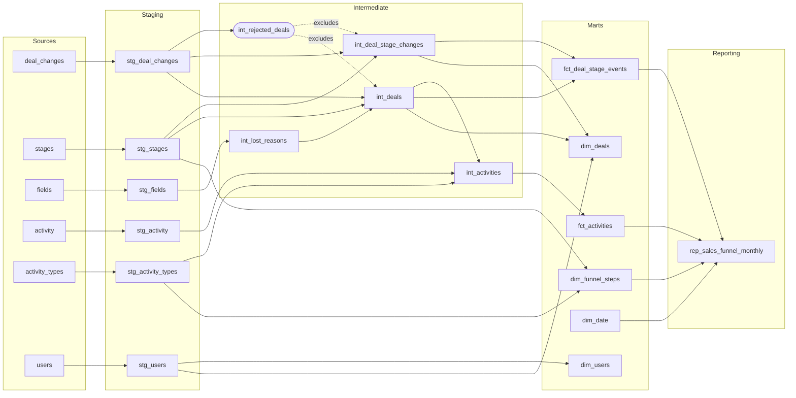

## Setup

1. Download Docker Desktop (if you don’t have installed) using the official website, install and launch.
2. Fork this Github project to you Github account. Clone the forked repo to your device.
3. Open your Command Prompt or Terminal, navigate to that folder, and run the command `docker compose up`.
4. Now you have launched a local Postgres database with the following credentials:
 ```
    Host: localhost
    User: admin
    Password: admin
    Port: 5432 
```
5. Connect to the db via a preferred tool (e.g. DataGrip, Dbeaver etc)
6. Install dbt-core and dbt-postgres using pip (if you don’t have) on your preferred environment.
7. Now you can run `dbt run` with the test model and check public_pipedrive_analytics schema to see the dbt result (with one test model)

## Project
1. Remove the test model once you make sure it works
2. Dive deep into the Pipedrive CRM source data to gain a thorough understanding of all its details. (You may also research the Pipedrive CRM tool terms).
3. Define DBT sources and build the necessary layers organizing the data flow for optimal relevance and maintainability.
4. Build a reporting model (rep_sales_funnel_monthly) with monthly intervals, incorporating the following funnel steps (KPIs):  
  &nbsp;&nbsp;&nbsp;Step 1: Lead Generation  
  &nbsp;&nbsp;&nbsp;Step 2: Qualified Lead  
  &nbsp;&nbsp;&nbsp;&nbsp;&nbsp;&nbsp;Step 2.1: Sales Call 1  
  &nbsp;&nbsp;&nbsp;Step 3: Needs Assessment  
  &nbsp;&nbsp;&nbsp;&nbsp;&nbsp;&nbsp;Step 3.1: Sales Call 2  
  &nbsp;&nbsp;&nbsp;Step 4: Proposal/Quote Preparation  
  &nbsp;&nbsp;&nbsp;Step 5: Negotiation  
  &nbsp;&nbsp;&nbsp;Step 6: Closing  
  &nbsp;&nbsp;&nbsp;Step 7: Implementation/Onboarding  
  &nbsp;&nbsp;&nbsp;Step 8: Follow-up/Customer Success  
  &nbsp;&nbsp;&nbsp;Step 9: Renewal/Expansion
5. Column names of the reporting model: `month`, `kpi_name`, `funnel_step`, `deals_count`
6. “Git commit” all the changes and create a PR to your forked repo (not the original one). Send your repo link to us.


---

# Solution Documentation

Everything above this line is the original assignment text. Everything below documents the solution.

## Status

| Part | Status |
|---|---|
| Sources (6 tables) | Done |
| Staging layer (6 models) | Done |
| Intermediate layer (5 models, one of them ephemeral) | Done |
| Marts layer (6 models, star schema) | Done |
| Reporting model `rep_sales_funnel_monthly` | Done |
| Data tests | Done |

The column-level documentation and the entity relationship diagram are in [DATA_DICTIONARY.md](docs/DATA_DICTIONARY.md).

## Architecture: Three Layers

The data flows through three modelling layers: staging, intermediate and marts. Reporting models sit on top of the marts and answer one specific request each. Each layer has its own folder, its own database schema and a default materialization, all set in `dbt_project.yml`.

| Layer | Folder | Schema | Materialization | Purpose |
|---|---|---|---|---|
| Staging | `models/staging/` | `public_pipedrive_staging` | View | A clean 1:1 copy of each source table |
| Intermediate | `models/intermediate/` | `public_pipedrive_intermediate` | View | Reshaping and business logic |
| Marts | `models/marts/` | `public_pipedrive_marts` | Table | The star schema that reports and BI tools query |
| Reporting | `models/reporting/` | `public_pipedrive_reporting` | Table | built only from the marts |



### Layer 1: Staging

One model per source table, with the same rows as the source. Staging only renames columns to consistent names. It has no joins, no filters and no business logic, and it is the only layer that reads from the sources.

| Model | Source table | What changes |
|---|---|---|
| `stg_deal_changes` | `deal_changes` | `change_time` becomes `changed_at` |
| `stg_activity` | `activity` | `type` becomes `activity_type`, `assigned_to_user` becomes `assigned_user_id`, `done` becomes `is_done`, `due_to` becomes `due_at` |
| `stg_activity_types` | `activity_types` | `id` becomes `activity_type_id`, `type` becomes `activity_type`, `name` becomes `activity_type_name`, `active` becomes `is_active` (still the text Yes or No) |
| `stg_stages` | `stages` | Nothing |
| `stg_fields` | `fields` | `id` becomes `field_id`, `name` becomes `field_name` |
| `stg_users` | `users` | `id` becomes `user_id`, `name` becomes `user_name`, `email` becomes `user_email`, `modified` becomes `modified_at` |

### Layer 2: Intermediate

All reshaping and business logic lives here. The source has no deals table, only a log of field changes, so this layer rebuilds the deals and their stage history from that log.

This is also the only layer that filters data. Deals that fail a data quality rule are listed in `int_rejected_deals` and left out of the deal models, so the marts are clean without filters of their own. All other known data problems are kept and flagged with a column. See the Data Quality section below.

| Model | One row per | What it does |
|---|---|---|
| `int_rejected_deals` | rejected deal | Lists the deal ids that are rejected for data quality reasons: currently the deal ids with more than one creation event. Ephemeral, so it is not created in the database |
| `int_lost_reasons` | lost reason | Flattens the JSON option list of the `lost_reason` field into rows |
| `int_deal_stage_changes` | deal and stage entry | Keeps the stage changes of the accepted deals from the change log, adds the stage name, the time the deal left the stage (`exited_at`) and whether it is the first entry into that stage (`is_first_entry`) |
| `int_deals` | deal | Rebuilds the current state of each accepted deal: creation time, current owner, current stage, lost time and lost reason |
| `int_activities` | activity | Joins activities to their type, converts the Yes/No text to true/false, adds a generated unique key and flags whether the deal exists in the change log |

### Layer 3: Marts

The marts are a star schema: two fact tables and four dimensions. Facts hold keys and measures, dimensions hold the descriptive details. No fact joins a dimension inside the marts; reports combine them. This keeps the facts narrow and lets each report choose its own roll-up, for example by week or by month through `dim_date`.

| Model | Type | Grain | Purpose |
|---|---|---|---|
| `fct_deal_stage_events` | Fact | deal, stage and entry time | Each time a deal enters a stage. Source of funnel steps 1 to 9. Adds `entered_date`, `days_in_stage` and `is_current_stage` |
| `fct_activities` | Fact | activity | Each scheduled activity. Source of funnel steps 2.1 (Sales Call 1) and 3.1 (Sales Call 2). Adds `due_date` |
| `dim_deals` | Dimension | deal | Current state of each deal, including the owner's id and name, plus the furthest stage reached, the number of stages entered and the days from creation to lost |
| `dim_users` | Dimension | user | User names, for deal owners and for the users activities are assigned to |
| `dim_date` | Dimension | day | Calendar for a fixed range, 2023-12-01 to 2026-03-31. Facts join to it on `entered_date` and `due_date` |
| `dim_funnel_steps` | Dimension | funnel step | The definition of the funnel: the 11 steps with their label, KPI name and order. Stage events join to it on `stage_id`, activities on `activity_type` |

The relationships between these tables are shown in the ERD in [DATA_DICTIONARY.md](docs/DATA_DICTIONARY.md).

### Reporting: rep_sales_funnel_monthly

The report requested in the assignment. It shows how many deals entered each funnel step in each month, and it reads only from the marts: `fct_deal_stage_events`, `fct_activities`, `dim_date` and `dim_funnel_steps`.

| Column | Meaning |
|---|---|
| `month` | First day of the month |
| `kpi_name` | Name of the funnel step |
| `funnel_step` | Label of the funnel step, `Step 1` to `Step 9`, plus `Step 2.1` and `Step 3.1` |
| `deals_count` | Number of distinct deals that entered the step in the month |

The table has one row per month and funnel step: 14 months (2024-01 to 2025-02) and 11 steps, 154 rows.

How the deals are counted:

| Rule | Detail |
|---|---|
| Steps 1 to 9 | A deal is counted in the month it entered the pipeline stage for the first time. Each deal counts once per stage |
| Steps 2.1 and 3.1 | A deal is counted in the month of a completed Sales Call 1 or Sales Call 2 (`is_done = true`). A call that was scheduled but not completed did not happen, so it is not counted. The month is the due month of the call, because the source has no completion date |
| Months without deals | Every month between the first and the last funnel event has a row for every step. A step that no deal entered has a `deals_count` of 0, so a gap in a chart is never mistaken for missing data |
| Rejected deals | The five deal ids rejected for data quality reasons are not counted (see the Data Quality section) |
| Step names | Taken from `dim_funnel_steps`, which reads them from the source. Step 2 therefore reads `Qualified lead` |

Two things to keep in mind when reading the report:

- The sales call steps (2.1 and 3.1) and the stage steps come from two unrelated sets of deals, so they should not be compared with each other. A conversion rate from Qualified Lead to Sales Call 1 would not be meaningful. See issue 1 in the Data Quality section.
- The activity data ends on 2024-09-13, so steps 2.1 and 3.1 show 0 from October 2024 onwards.

## Source Data: Business Meaning per Table

| Table | Business meaning |
|---|---|
| `deal_changes` | The history of every deal (a sales opportunity with a potential customer). There is no deals table, so this log is the only record of deals. |
| `stages` | The steps of the sales pipeline, from Lead Generation (1) to Renewal/Expansion (9). These are funnel steps 1–9 in the report. |
| `activity` | Tasks that sales reps schedule against a deal, such as calls and meetings. |
| `activity_types` | The kinds of activity that exist, and whether each is still in use. |
| `fields` | Definitions of the deal fields that can change, plus the allowed options for dropdown fields. |
| `users` | The Pipedrive users: sales reps who own deals and are assigned activities. |

## Findings from Data Exploration

The profiling queries are saved in the `analyses/` folder, one query per file, each with its result as a comment.

| Finding | Detail | How the model handles it |
|---|---|---|
| There is no deals table | Deals exist only as a log of field changes (`add_time`, `stage_id`, `user_id`, `lost_reason`) | `int_deals` and `int_deal_stage_changes` rebuild them |
| Deals skip stages | For example 1 > 2 > 4. The most common path, 1 > 2 > 3 > 4, covers only 82 of 1,995 deals | A deal has stage rows only for the stages it actually entered |
| Five deal ids were created twice | Each has two creation events and two mixed histories. They are the only deals that re-enter a stage | Rejected: listed in `int_rejected_deals` and left out of the deal models and the marts |
| Activity ids are not unique | 11 ids are shared by two different activities | `activity_key` is generated as the unique key |
| Activities do not match the deal change log | Only 8 of 4,572 activity deal ids exist in `deal_changes` | Activities and stage events are separate facts; `has_deal_history` shows the match, and no activity is dropped |
| A deal enters stage 1 after it is created | Creation and entering Lead Generation are different events | Funnel step 1 is taken from the stage change, not from the creation time |
| Every deal ends up lost | All 1,995 deals have a lost reason, including the 324 that reach stage 9 | No test assumes this, because live data would also have open and won deals |
| Stage 2 is named differently in two tables | `Qualified lead` in `stages`, `Qualified Lead` in `fields` | Stage names are taken only from the `stages` table, as they are, so stage 2 reads `Qualified lead`. The stages in the `fields` JSON are not used |
| The activity type flag is text | `activity_types.active` holds Yes or No | Converted to true/false in `int_activities` |

## Data Quality: Known Issues and Assumptions

Three problems in the source data cannot be fixed in the model. Two of them are kept and flagged with a column. The third, deal ids that were created twice, is rejected: those deals are dropped from the model. All three are reported by a test with severity `warn` on every run. The assumptions made for each are listed below with examples from the data.

| Issue | Records affected | Handling |
|---|---|---|
| 1. Activities point to deals that have no history | 4,571 of 4,579 activities | Kept and flagged |
| 2. Activity ids are not unique | 11 ids, 22 activities | Kept, with a generated key |
| 3. Deal ids created twice | 5 of 1,995 deal ids | Rejected (dropped) |

### Issue 1: Activities point to deals that have no history

4,571 of 4,579 activities belong to a deal id that does not exist in `deal_changes`. Only 8 of the 4,572 activity deal ids are found there.

Examples of activities whose deal has no row in `deal_changes`:

| `deal_id` | Activity | Done | Due date |
|---|---|---|---|
| 100393 | Sales Call 2 | Yes | 2024-02-17 |
| 100994 | Sales Call 1 | No | 2024-04-07 |
| 100007 | Follow Up Call | Yes | 2024-07-08 |

Assumption:
- Every activity is kept and counted. Funnel steps 2.1 and 3.1 are counted from the activities alone, by distinct `deal_id`.

In the model: `has_deal_history` on `int_activities` and `fct_activities` shows whether the deal is known.

### Issue 2: Activity ids are not unique

11 activity ids are each used by two rows (22 rows in total).

Examples:

| `activity_id` | Activity | `deal_id` | Assigned user | Done | Due date |
|---|---|---|---|---|---|
| 206894 | Sales Call 2 | 364268 | 1042 | Yes | 2024-01-20 |
| 206894 | Sales Call 2 | 669962 | 332 | No | 2024-04-28 |
| 283308 | Sales Call 1 | 316693 | 503 | No | 2024-05-01 |
| 283308 | After Close Call | 334455 | 341 | No | 2024-09-13 |

Assumptions:

- The two rows of a pair are two different activities that share an id by mistake. They differ in deal, user and date, and sometimes in type, so they are not the same activity loaded twice.
- Both rows are kept. Removing one of them would lose a real activity.

In the model: `activity_key` is generated from the activity id, deal id, type, assigned user and due time, and is the unique key of an activity. `activity_id` is kept as a normal column.

### Issue 3: Five deal ids were created twice (rejected records)

Five deal ids (399956, 554294, 556338, 851850, 955417) each have two creation events, two passes through the stages and two lost reasons.

Example, deal 399956:

| Event | First time | Second time |
|---|---|---|
| Deal created | 2024-04-06 | 2024-06-29 |
| Entered stage 1 | 2024-05-07 | 2024-08-18 |
| Marked as lost | 2024-08-01 | 2024-09-08 |

The second creation happens while the first history is still running, and the two histories are interleaved in time.

Assumptions:

- Each of these ids holds two different deals that were given the same id by mistake. They are not treated as one deal that was reopened, because the second history starts before the first one ends.
- The two deals cannot be separated reliably. Treating the id as one deal would give it a wrong creation date, owner, current stage and time in stage.
- These deal ids are therefore rejected and dropped from the model. Counting them wrongly is considered worse than leaving them out.

How the rejection works:

- `int_rejected_deals` lists every deal id with more than one creation event, with the reason, the number of creation events and the first and last creation time. The rule is general, so a new deal id with the same problem is rejected automatically.
- The model is ephemeral: it is not created in the database, and dbt inlines it into the models that use it.
- `int_deals` and `int_deal_stage_changes` leave out every deal id listed there. The marts are built from these two models, so `dim_deals` and `fct_deal_stage_events` do not contain the rejected deals either.
- The test `assert_no_rejected_deals` returns the rejected deals as a warning on every run. It reports 5 today, and a higher number would show that more deals are being rejected.

To list the rejected deals, query the source directly:

```sql
select deal_id, count(*) as creation_events
from deal_changes
where changed_field_key = 'add_time'
group by deal_id
having count(*) > 1;
```

## Moving to a Live Environment

The project runs on a small, static extract. This section describes what would change in a live environment with growing data. The layers and the business logic stay the same.

### Materialization

| Layer / model | Now | In a live environment | Why |
|---|---|---|---|
| Staging | Views | Views | They only rename columns, so storing a copy adds nothing. A very large source could become an incremental model |
| `int_deals`, `int_deal_stage_changes` | Views | Tables | They run window functions over the whole change log and are read by several marts. As views, that work is repeated in every model that uses them |
| `int_rejected_deals` | Ephemeral | Table | So that the rejected records can be queried, audited and monitored over time |
| `int_lost_reasons`, `int_activities` | Views | Views | Light logic |
| `fct_deal_stage_events`, `fct_activities` | Tables, fully rebuilt | Incremental | Event data only grows. Processing only the new events avoids rebuilding the full history on every run |
| `dim_deals`, `dim_users`, `dim_funnel_steps` | Tables | Tables | Small enough to rebuild in full |
| `dim_date` | Table with a fixed range ending 2026-03-31 | Table with a longer fixed range | The end date has to stay ahead of the data |
| `rep_sales_funnel_monthly` | Table | Table, or incremental by month | Only the recent months change |

### Optimization

- **Partition and cluster the fact tables by date.** Queries for a period then scan only the months they need. `entered_date` and `due_date` are the natural keys for this.
- **Reprocess whole deals in incremental runs.** `exited_at` and `is_first_entry` depend on the full history of a deal. An incremental run therefore has to reprocess every deal that received a new event, not only the new rows.
- **Allow for late-arriving data.** Incremental models should look back a few days, so that events loaded late are still picked up.
- **Keep the heavy logic in one place.** The window functions run once in the intermediate layer and the marts read the result, so making those two intermediate models tables removes the repeated work.

## Data Tests

The project has 66 tests. On the current data 63 pass and 3 report a warning for a known source issue. Tests are defined on the intermediate layer, where the business logic lives, on the marts, which other people query, and on the report.

- **Single-column tests** (`unique`, `not_null`, `accepted_values`, `relationships`) use dbt's built-in tests and are declared in `models/intermediate/intermediate.yml`, `models/marts/marts.yml` and `models/reporting/reporting.yml`.
- **Multi-column and cross-column tests** (uniqueness over several columns, ordering of timestamps, consistency between columns) are written as custom SQL files in the `tests/` folder. Each file returns the rows that break the rule, so the test passes when it returns nothing.

The `dbt_utils` package offers ready-made tests for some of these checks, for example `dbt_utils.unique_combination_of_columns` and `dbt_utils.expression_is_true`. For this project we use custom SQL files instead, which keeps the project free of package dependencies (no `dbt deps` step) and keeps each rule readable as plain SQL.

### Custom SQL tests

The `tests/` folder holds five custom SQL tests.

| Test file | Model checked | Rule | Purpose | Severity |
|---|---|---|---|---|
| `assert_int_deal_stage_changes_unique_stage_entry.sql` | `int_deal_stage_changes` | The combination of `deal_id`, `stage_id` and `entered_at` is unique | Protects the grain of the stage history. A duplicated stage entry would inflate every funnel count. This is the combination-key test that `dbt_utils.unique_combination_of_columns` would otherwise provide | Error |
| `assert_int_deals_lost_after_creation.sql` | `int_deals` | `lost_at` is not before `created_at` | Catches deals with an impossible timeline, which would point to wrong or mixed-up events in the source | Error |
| `assert_int_deals_lost_reason_matches_is_lost.sql` | `int_deals` | A lost deal has a lost reason label, and a deal that is not lost has none | Catches a lost reason id that has no label in the `fields` JSON, for example a new reason added in the CRM | Error |
| `assert_dim_funnel_steps_has_sales_call_steps.sql` | `dim_funnel_steps` | Step 2.1 and Step 3.1 both exist | The two sales call steps are joined to the activity types. Without this test a step would silently disappear from the funnel if its activity type were removed or renamed in the source | Error |
| `assert_no_rejected_deals.sql` | `int_rejected_deals` | No deal is rejected | Reports on every run how many deals are dropped for data quality reasons, so it is noticed if the number grows. It currently reports the five deal ids that were created twice | Warn |

A test with severity `error` stops `dbt build` and everything downstream of the failing model is skipped. A test with severity `warn` is reported and the build continues.

### Warnings on the current data

Tests with severity `warn` report known issues in the source data, or changes that need a decision, without stopping the build. The three warnings on the current data are:

| Test | Result | Meaning |
|---|---|---|
| `int_activities.deal_id` exists in `int_deals` | 4,571 rows | Activities whose deal has no history in the change log |
| `int_activities.activity_id` is unique | 11 ids | Activity ids shared by two activities |
| `assert_no_rejected_deals` | 5 deals | The five deal ids that were created twice and are rejected from the model |

## Project Structure

```
analyses/              profiling queries from the data exploration
models/
  sources.yml          the six source tables
  staging/             stg_ models and staging.yml
  intermediate/        int_ models and intermediate.yml
  marts/               dim_ and fct_ models and marts.yml
  reporting/           rep_ models and reporting.yml
tests/                 custom SQL tests
docs/
  DATA_DICTIONARY.md   ERD and column-level documentation
```
