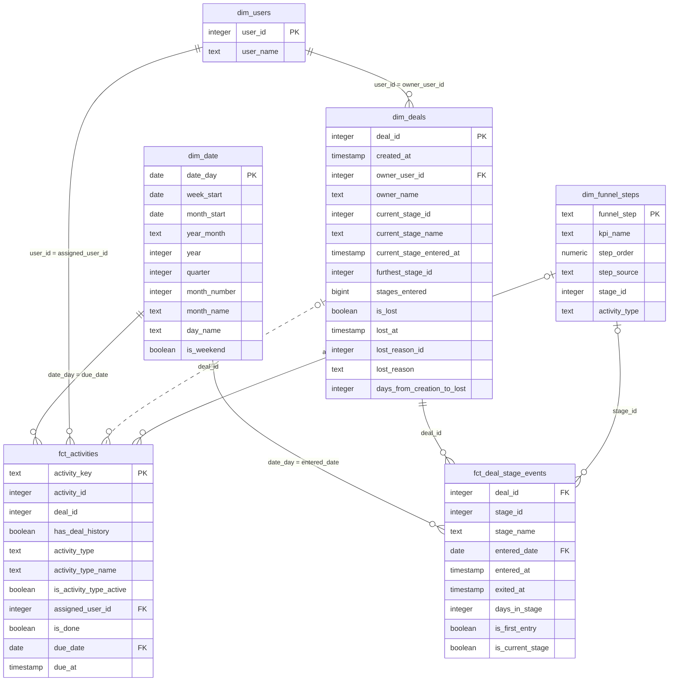

# Data Dictionary

This document describes every table and column in the project, layer by layer, and shows how the marts relate to each other.

- [Entity Relationship Diagram](#entity-relationship-diagram)
- [Reporting](#reporting)
- [Marts](#marts)
- [Intermediate](#intermediate)
- [Staging](#staging)
- [Sources](#sources)

The same descriptions are kept in the YAML files next to the models (`sources.yml`, `staging.yml`, `intermediate.yml`, `marts.yml`, `reporting.yml`), so `dbt docs generate` produces them as a browsable site.

## Entity Relationship Diagram

The marts form a star schema with two fact tables and four dimensions.

### Relationships

| From | To | Join | Notes |
|---|---|---|---|
| `fct_deal_stage_events` | `dim_deals` | `deal_id = deal_id` | Every stage event has a deal. Tested. |
| `fct_deal_stage_events` | `dim_date` | `entered_date = date_day` | Tested. |
| `fct_activities` | `dim_date` | `due_date = date_day` | Tested. |
| `fct_activities` | `dim_users` | `assigned_user_id = user_id` | Tested (warning level). |
| `dim_deals` | `dim_users` | `owner_user_id = user_id` | Tested (warning level). The owner's name is also stored on `dim_deals` as `owner_name`, so this join is only needed for other user details. |
| `fct_deal_stage_events` | `dim_funnel_steps` | `stage_id = stage_id` | Every stage event belongs to one stage step. |
| `fct_activities` | `dim_funnel_steps` | `activity_type = activity_type` | Only Sales Call 1 and Sales Call 2 activities match. The other activity types are not funnel steps. |
| `fct_activities` | `dim_deals` | `deal_id = deal_id` | Not reliable: only 8 of 4,572 activity deal ids exist in `dim_deals`. Shown as a dotted line. Use `has_deal_history` to see which rows match. |

The key of `fct_deal_stage_events` is the combination of `deal_id`, `stage_id` and `entered_at`.

## Reporting

Schema `public_pipedrive_reporting`. Built as tables. Reporting models read only from the marts.

### rep_sales_funnel_monthly

Monthly sales funnel: how many deals entered each funnel step in each month. One row per month and funnel step, for every month between the first and the last funnel event (154 rows: 14 months and 11 steps). The key is the combination of `month` and `funnel_step`.

Built from `fct_deal_stage_events`, `fct_activities`, `dim_date` and `dim_funnel_steps`.

| Column | Type | Description |
|---|---|---|
| `month` | date | First day of the month. |
| `kpi_name` | text | Name of the funnel step, from `dim_funnel_steps`. |
| `funnel_step` | text | Label of the funnel step, for example Step 1 or Step 2.1. Joins to `dim_funnel_steps.funnel_step`. |
| `deals_count` | bigint | Number of distinct deals that entered the funnel step in the month. 0 when no deal entered the step. |

How `deals_count` is calculated:

| Funnel steps | Counted from | Rule |
|---|---|---|
| Step 1 to Step 9 | `fct_deal_stage_events` | Distinct deals that entered the stage for the first time (`is_first_entry`), in the month of `entered_date`. |
| Step 2.1 and Step 3.1 | `fct_activities` | Distinct deals with a completed sales call (`is_done`), in the month of `due_date`. |

The stage steps and the sales call steps come from two unrelated sets of deals, so they should not be compared with each other.

## Marts

Schema `public_pipedrive_marts`. Built as tables.

### dim_deals

One row per deal: its current state and how far it got in the funnel. Holds only deals that appear in the deal change log, without the deals rejected for data quality reasons (see `int_rejected_deals`).

| Column | Type | Description |
|---|---|---|
| `deal_id` | integer | Id of the deal. Key of the table. |
| `created_at` | timestamp | When the deal was created. |
| `owner_user_id` | integer | The current owner of the deal. Joins to `dim_users.user_id`. |
| `owner_name` | text | Name of the current owner, copied from the users so that no extra join is needed. |
| `current_stage_id` | integer | The stage the deal entered most recently. |
| `current_stage_name` | text | Name of the stage the deal entered most recently. |
| `current_stage_entered_at` | timestamp | When the deal entered its current stage. |
| `furthest_stage_id` | integer | The highest stage the deal ever entered. |
| `stages_entered` | bigint | How many different stages the deal entered. Deals can skip stages. |
| `is_lost` | boolean | Whether the deal was marked as lost. |
| `lost_at` | timestamp | When the deal was marked as lost. |
| `lost_reason_id` | integer | Id of the lost reason. |
| `lost_reason` | text | Label of the lost reason, for example Pricing Issues. |
| `days_from_creation_to_lost` | integer | Whole days between the creation of the deal and it being lost. Empty for deals that are not lost. |

### dim_users

One row per Pipedrive user. Serves two roles: the owner of a deal and the user an activity is assigned to. Email addresses are left out on purpose. The owner's name is also available directly on `dim_deals` as `owner_name`.

| Column | Type | Description |
|---|---|---|
| `user_id` | integer | Id of the user. Key of the table. |
| `user_name` | text | Full name of the user. |

### dim_date

Calendar with one row per day for a fixed range, 2023-12-01 to 2026-03-31 (852 days), generated without reading any table. The range runs from one month before the earliest date in the data to one year after the latest.

| Column | Type | Description |
|---|---|---|
| `date_day` | date | The day. Key of the table. |
| `week_start` | date | Monday of the week the day belongs to. |
| `month_start` | date | First day of the month the day belongs to. |
| `year_month` | text | Year and month as text, for example 2024-01. |
| `year` | integer | Calendar year. |
| `quarter` | integer | Calendar quarter, 1 to 4. |
| `month_number` | integer | Month of the year, 1 to 12. |
| `month_name` | text | Name of the month, for example January. |
| `day_name` | text | Name of the weekday, for example Monday. |
| `is_weekend` | boolean | True for Saturday and Sunday. |

### dim_funnel_steps

The definition of the sales funnel, one row per funnel step. Steps 1 to 9 come from the pipeline stages. Steps 2.1 and 3.1 are the two sales calls; their position in the funnel exists in no source table and is set in this model.

| Column | Type | Description |
|---|---|---|
| `funnel_step` | text | Label of the step, for example Step 1 or Step 2.1. Key of the table. |
| `kpi_name` | text | Name of the step: the stage name for stage steps, the activity type name for sales call steps. |
| `step_order` | numeric | Position of the step in the funnel as a number. Use it for sorting, because the text label sorts Step 10 before Step 2. |
| `step_source` | text | `stage` or `activity`: what feeds the step. |
| `stage_id` | integer | The stage that feeds the step. Joins to `fct_deal_stage_events.stage_id`. Empty for sales call steps. |
| `activity_type` | text | The activity type that feeds the step. Joins to `fct_activities.activity_type`. Empty for stage steps. |

Values:

| `funnel_step` | `kpi_name` | `step_order` | `step_source` | `stage_id` | `activity_type` |
|---|---|---|---|---|---|
| Step 1 | Lead Generation | 1 | stage | 1 | |
| Step 2 | Qualified lead | 2 | stage | 2 | |
| Step 2.1 | Sales Call 1 | 2.1 | activity | | meeting |
| Step 3 | Needs Assessment | 3 | stage | 3 | |
| Step 3.1 | Sales Call 2 | 3.1 | activity | | sc_2 |
| Step 4 | Proposal/Quote Preparation | 4 | stage | 4 | |
| Step 5 | Negotiation | 5 | stage | 5 | |
| Step 6 | Closing | 6 | stage | 6 | |
| Step 7 | Implementation/Onboarding | 7 | stage | 7 | |
| Step 8 | Follow-up/Customer Success | 8 | stage | 8 | |
| Step 9 | Renewal/Expansion | 9 | stage | 9 | |

### fct_deal_stage_events

One row each time a deal enters a stage. Source of funnel steps 1 to 9. Deals can skip stages, so a deal only has rows for the stages it actually entered.

| Column | Type | Description |
|---|---|---|
| `deal_id` | integer | The deal that moved. Joins to `dim_deals.deal_id`. |
| `stage_id` | integer | The stage the deal entered, 1 to 9. |
| `stage_name` | text | Name of the stage the deal entered. |
| `entered_date` | date | The day the deal entered the stage. Joins to `dim_date.date_day`. |
| `entered_at` | timestamp | The exact time the deal entered the stage. |
| `exited_at` | timestamp | When the deal moved on to its next stage. Empty for the deal's latest stage. |
| `days_in_stage` | integer | Whole days the deal spent in the stage. For the deal's latest stage the end point is the time the deal was lost; empty if the deal is still open. |
| `is_first_entry` | boolean | True the first time the deal enters this stage, false on a re-entry. On the current data every row is a first entry. |
| `is_current_stage` | boolean | True for the stage the deal entered most recently. |

### fct_activities

One row per activity scheduled against a deal. Source of funnel steps 2.1 (Sales Call 1) and 3.1 (Sales Call 2).

| Column | Type | Description |
|---|---|---|
| `activity_key` | text | Generated unique key of the activity. Key of the table. |
| `activity_id` | integer | Pipedrive activity id. Not unique, 11 ids are shared by two different activities. |
| `deal_id` | integer | The deal the activity belongs to. Never empty, but rarely present in `dim_deals`. |
| `has_deal_history` | boolean | Whether the deal id exists in `dim_deals`. |
| `activity_type` | text | Key of the activity type, for example `meeting` or `sc_2`. |
| `activity_type_name` | text | Display name of the activity type, for example Sales Call 1. |
| `is_activity_type_active` | boolean | Whether the activity type is still in use. |
| `assigned_user_id` | integer | The user the activity is assigned to. Joins to `dim_users.user_id`. |
| `is_done` | boolean | Whether the activity was completed. |
| `due_date` | date | The day the activity is or was due. Joins to `dim_date.date_day`. The source has no completion date, so this is also the best available date for a completed activity. |
| `due_at` | timestamp | The exact time the activity is or was due. |

Activity types:

| `activity_type` | `activity_type_name` | Funnel step |
|---|---|---|
| `meeting` | Sales Call 1 | 2.1 |
| `sc_2` | Sales Call 2 | 3.1 |
| `follow_up` | Follow Up Call (no longer active) | Not in the funnel |
| `after_close_call` | After Close Call | Not in the funnel |

## Intermediate

Schema `public_pipedrive_intermediate`. Built as views, except `int_rejected_deals`, which is ephemeral.

### int_rejected_deals

Deals rejected from the model for data quality reasons, one row per rejected deal id. A deal id with more than one creation event holds two different deals mixed under one id, so it is left out of `int_deals` and `int_deal_stage_changes`, and therefore of the marts.

This model is ephemeral: it is not created in the database, and dbt inlines it into the models that use it. The test `assert_no_rejected_deals` reports its rows as a warning on every run. It currently holds 5 deal ids: 399956, 554294, 556338, 851850 and 955417.

| Column | Type | Description |
|---|---|---|
| `deal_id` | integer | Id of the rejected deal. |
| `rejection_reason` | text | Why the deal is rejected. Currently always "More than one creation event". |
| `creation_events` | bigint | Number of creation (`add_time`) events found for the deal id. |
| `first_created_at` | timestamp | Time of the earliest creation event. |
| `last_created_at` | timestamp | Time of the latest creation event. |

### int_lost_reasons

The reasons a deal can be lost, one row per reason. Flattened from the JSON option list of the `lost_reason` field in `stg_fields`.

| Column | Type | Description |
|---|---|---|
| `lost_reason_id` | integer | Id of the lost reason, the value stored in the deal change log. |
| `lost_reason` | text | Label of the lost reason. |

Values: 1 Customer Not Ready, 2 Pricing Issues, 3 Unreachable Customer, 4 Product Mismatch, 5 Duplicate Entry.

### int_deal_stage_changes

Stage history of every deal, one row each time a deal enters a stage. Deals listed in `int_rejected_deals` are left out.

| Column | Type | Description |
|---|---|---|
| `deal_id` | integer | The deal that moved. |
| `stage_id` | integer | The stage the deal entered. |
| `stage_name` | text | Name of the stage, from `stg_stages`. Empty, and failing the `not_null` test, for a stage id that is missing from `stg_stages`. |
| `entered_at` | timestamp | When the deal entered the stage. |
| `exited_at` | timestamp | When the deal moved on to its next stage. Empty for the deal's latest stage, even if the deal was lost afterwards: to measure time in the final stage, use `lost_at` from `int_deals` as the end point. |
| `is_first_entry` | boolean | True the first time the deal enters this stage, false on a re-entry. On the current data every row is a first entry, because the only deals with re-entries are the ones rejected in `int_rejected_deals`. |

### int_deals

One row per deal with its current state, rebuilt from the deal change log because the source has no deals table. Deal ids that exist only on activities are not included, and deals listed in `int_rejected_deals` are left out.

| Column | Type | Description |
|---|---|---|
| `deal_id` | integer | Id of the deal. |
| `created_at` | timestamp | When the deal was created (its `add_time` event). |
| `owner_user_id` | integer | The current owner of the deal. Earlier owners are not kept. |
| `current_stage_id` | integer | The stage the deal entered most recently. |
| `current_stage_name` | text | Name of the stage the deal entered most recently. |
| `current_stage_entered_at` | timestamp | When the deal entered its current stage. |
| `is_lost` | boolean | Whether the deal was marked as lost. |
| `lost_at` | timestamp | When the deal was marked as lost. |
| `lost_reason_id` | integer | Id of the lost reason. |
| `lost_reason` | text | Label of the lost reason. |

### int_activities

Activities scheduled against deals, one row per activity, with the details of the activity type. Every activity is kept, whether or not its deal exists in `int_deals`.

| Column | Type | Description |
|---|---|---|
| `activity_key` | text | Generated unique key (a hash of activity id, deal id, type, assigned user and due time), because `activity_id` is shared by unrelated activities. |
| `activity_id` | integer | Pipedrive activity id (not unique). |
| `deal_id` | integer | The deal the activity belongs to. Never empty. |
| `has_deal_history` | boolean | Whether the deal id exists in `int_deals`. False for almost all activities. |
| `activity_type` | text | Key of the activity type. |
| `activity_type_name` | text | Display name of the activity type. |
| `is_activity_type_active` | boolean | Whether the activity type is still in use, converted from Yes/No to true/false. |
| `assigned_user_id` | integer | The user the activity is assigned to. |
| `is_done` | boolean | Whether the activity was completed. |
| `due_at` | timestamp | When the activity is or was due. |

## Staging

Schema `public_pipedrive_staging`. Built as views. Each model has the same rows as its source table, with columns renamed.

### stg_deal_changes

| Column | Type | Source column | Description |
|---|---|---|---|
| `deal_id` | integer | `deal_id` | The deal that changed. |
| `changed_field_key` | text | `changed_field_key` | The field that changed: `add_time`, `stage_id`, `user_id` or `lost_reason`. |
| `new_value` | text | `new_value` | The new value of the field, stored as text. Its meaning depends on `changed_field_key`. |
| `changed_at` | timestamp | `change_time` | When the change happened. |

### stg_activity

| Column | Type | Source column | Description |
|---|---|---|---|
| `activity_id` | integer | `activity_id` | Pipedrive activity id. Not unique. |
| `deal_id` | integer | `deal_id` | The deal the activity belongs to. |
| `activity_type` | text | `type` | The kind of activity. Matches `stg_activity_types.activity_type`. |
| `assigned_user_id` | integer | `assigned_to_user` | The user the activity is assigned to. |
| `is_done` | boolean | `done` | Whether the activity was completed. |
| `due_at` | timestamp | `due_to` | When the activity is or was due. |

### stg_activity_types

| Column | Type | Source column | Description |
|---|---|---|---|
| `activity_type_id` | integer | `id` | Id of the activity type. |
| `activity_type` | text | `type` | Key of the activity type as used on activities. |
| `activity_type_name` | text | `name` | Display name, for example Sales Call 1. |
| `is_active` | text | `active` | Whether the type is still in use, as the text Yes or No. Converted to true/false in `int_activities`. |

### stg_stages

| Column | Type | Source column | Description |
|---|---|---|---|
| `stage_id` | integer | `stage_id` | Id of the stage, 1 to 9. |
| `stage_name` | text | `stage_name` | Name of the stage. |

Values: 1 Lead Generation, 2 Qualified lead, 3 Needs Assessment, 4 Proposal/Quote Preparation, 5 Negotiation, 6 Closing, 7 Implementation/Onboarding, 8 Follow-up/Customer Success, 9 Renewal/Expansion.

### stg_fields

| Column | Type | Source column | Description |
|---|---|---|---|
| `field_id` | integer | `id` | Id of the field. |
| `field_key` | text | `field_key` | Key of the field. Matches `stg_deal_changes.changed_field_key`. |
| `field_name` | text | `name` | Display name of the field. |
| `field_value_options` | jsonb | `field_value_options` | JSON list of options for dropdown fields (stage, lost reason). Empty for other fields. |

### stg_users

Contains personal data (name, email).

| Column | Type | Source column | Description |
|---|---|---|---|
| `user_id` | integer | `id` | Id of the user. |
| `user_name` | text | `name` | Full name of the user. |
| `user_email` | text | `email` | Email address. Not unique, four addresses are shared by two users each. |
| `modified_at` | timestamp | `modified` | When the user record was last changed. |

## Sources

Schema `public`. Raw Pipedrive CRM data, loaded from the CSV files in `raw_data/`.

| Table | Rows | Business meaning |
|---|---|---|
| `deal_changes` | 15,406 | The history of every deal, one row per field change. There is no deals table, so this log is the only record of deals. |
| `activity` | 4,579 | Tasks that sales reps schedule against a deal, such as calls and meetings. |
| `activity_types` | 4 | The kinds of activity that exist, and whether each is still in use. |
| `stages` | 9 | The steps of the sales pipeline, from Lead Generation (1) to Renewal/Expansion (9). |
| `fields` | 4 | Definitions of the deal fields that can change, plus the allowed options for dropdown fields. |
| `users` | 1,787 | The Pipedrive users: sales reps who own deals and are assigned activities. |

### deal_changes

| Column | Type | Description |
|---|---|---|
| `deal_id` | integer | The deal that changed. |
| `change_time` | timestamp | When the change happened. |
| `changed_field_key` | text | The field that changed. |
| `new_value` | text | The new value of the field. |

The meaning of `new_value` depends on `changed_field_key`:

| `changed_field_key` | Meaning | `new_value` holds |
|---|---|---|
| `add_time` | The deal was created | The creation timestamp |
| `stage_id` | The deal moved into a pipeline stage | A stage id, 1 to 9 |
| `user_id` | The owner of the deal changed | A user id |
| `lost_reason` | The deal was marked as lost | A lost reason id, 1 to 5 |

### activity

| Column | Type | Description |
|---|---|---|
| `activity_id` | integer | Pipedrive activity id. Not unique. |
| `type` | text | The kind of activity. Matches `activity_types.type`, not `activity_types.id`. |
| `assigned_to_user` | integer | The user the activity is assigned to. |
| `deal_id` | integer | The deal the activity belongs to. |
| `done` | boolean | Whether the activity was completed. |
| `due_to` | timestamp | When the activity is or was due. |

### activity_types

| Column | Type | Description |
|---|---|---|
| `id` | integer | Id of the activity type. |
| `name` | text | Display name. |
| `active` | text | Yes or No. |
| `type` | text | Key of the activity type, used by `activity.type`. |

### stages

| Column | Type | Description |
|---|---|---|
| `stage_id` | integer | Id of the stage. |
| `stage_name` | text | Name of the stage. |

### fields

| Column | Type | Description |
|---|---|---|
| `id` | integer | Id of the field. |
| `field_key` | text | Key of the field. |
| `name` | text | Display name of the field. |
| `field_value_options` | jsonb | JSON list of `{id, label}` options for dropdown fields. |

### users

| Column | Type | Description |
|---|---|---|
| `id` | integer | Id of the user. |
| `name` | text | Full name of the user. |
| `email` | text | Email address. |
| `modified` | timestamp | When the user record was last changed. |
